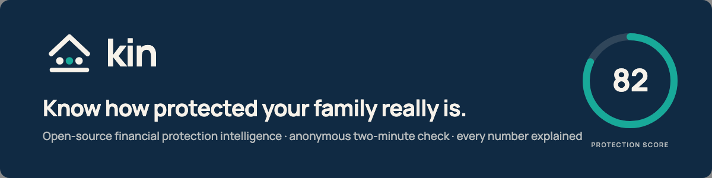
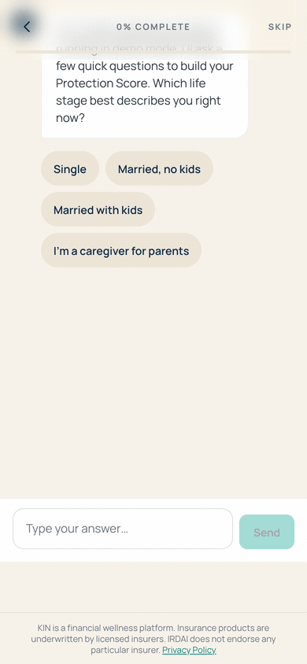
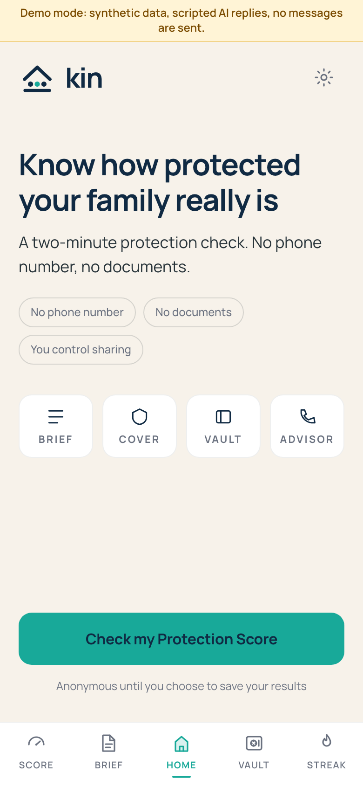
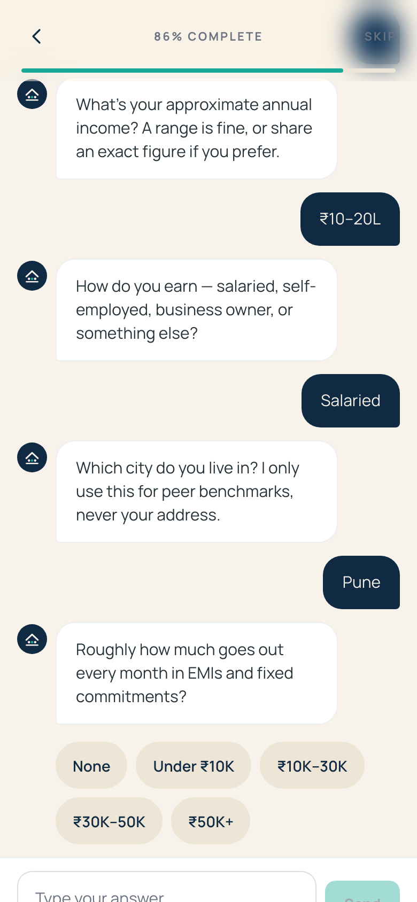
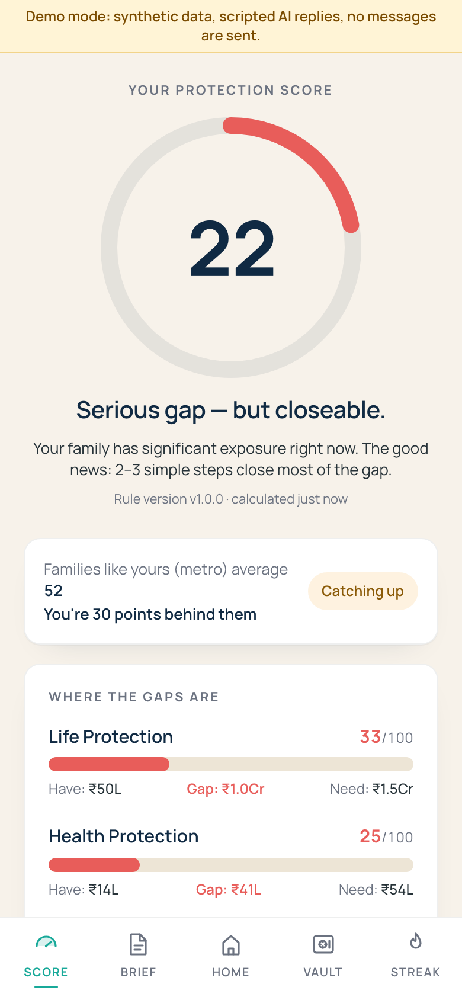
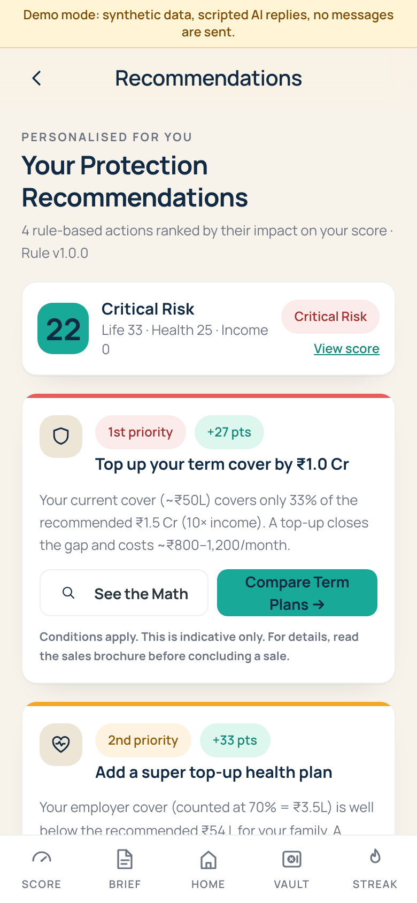
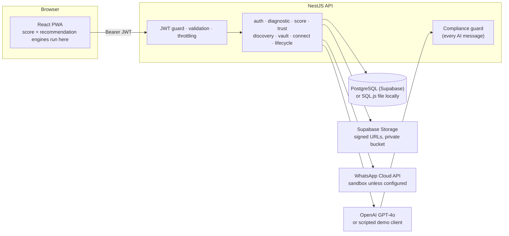

<p align="center">
  
</p>

<h1 align="center">KIN — Financial Protection Intelligence Platform</h1>

<p align="center">
  An open-source InsurTech app that gives a family a two-minute, anonymous read on their life, health and income protection gaps — with every number explained.
</p>

<p align="center">
  <a href="https://github.com/santoshbpathak/kin/actions/workflows/ci.yml"></a>
  
  <a href="LICENSE"></a>
  
  
  
  
  
</p>

<p align="center">
  <a href="#quick-start">Quick start</a> ·
  <a href="#demo-mode-no-keys-no-real-data">Demo mode</a> ·
  <a href="#how-the-protection-assessment-works">How it works</a> ·
  <a href="docs/financial-methodology.md">Methodology</a> ·
  <a href="docs/architecture.md">Architecture</a> ·
  <a href="CONTRIBUTING.md">Contributing</a> ·
  <a href="SECURITY.md">Security</a>
</p>

---

**Status:** pilot-quality MVP (v0.1.0), MIT licensed. Everything shown below runs locally in demo mode with synthetic data. KIN is not production-certified, regulator-approved or independently audited. Read the [security notes](docs/security/) before deploying it for real users.

## The problem

Most Indian households are under-insured and do not know it. Cover is spread across employers, banks and government schemes; the numbers are hard to compare; and the people offering to explain them usually earn commission on the answer. KIN is a personal-finance tool that gives a family a neutral first read — a **Protection Score** with the arithmetic shown — before anyone talks to a seller.

## See it

<p align="center">
  
</p>

<table>
  <tr>
    <td align="center"><br><sub>Home — anonymous by default</sub></td>
    <td align="center"><br><sub>Conversational diagnostic</sub></td>
    <td align="center"><br><sub>Score with rupee gaps</sub></td>
    <td align="center"><br><sub>Ranked, explainable actions</sub></td>
  </tr>
</table>

More screens (discovery, vault, streaks, advisor) are in [`docs/assets/README/`](docs/assets/README/). All captures come from demo mode on a phone viewport.

## What KIN does

| Feature | What you get | Where it lives |
|---|---|---|
| **Conversational diagnostic** | Twelve plain-language questions about dependants, income, commitments and existing cover; every field carries a confidence tag (confirmed, estimated, unknown) that the score screen discloses. Real GPT-4o when a key is configured, a deterministic script in demo mode. | `apps/api/src/modules/diagnostic` |
| **Protection Score** | Deterministic, versioned rules produce a 0–100 composite plus life, health and income sub-scores, each with the rupee amount you have, the amount recommended and the gap. | `apps/web/src/modules/score` |
| **See the Math** | Every recommendation ships its formula, basis text and the regulation or scheme it rests on, and is written to an immutable audit trail. | `apps/web/src/modules/trust`, `apps/api/src/modules/trust` |
| **Hidden coverage discovery** | Eight yes/no questions surface cover people already hold: EDLI, PMSBY, PMJJBY, ESI, motor personal accident, card and home-loan cover. | `apps/web/src/modules/discovery` |
| **Protection Vault** | Policy details and nominees behind a separate short-lived vault token; files go straight to private object storage through signed URLs. | `apps/api/src/modules/vault` |
| **AI advisor with human hand-off** | Tier-1 chat grounded in the user's own report, output filtered by a compliance guard (no insurer names, no premiums), escalation paths to human advisors. | `apps/api/src/modules/connect` |
| **Engagement** | Weekly briefs sourced from public regulators, a financial-literacy quiz, streaks. | `apps/web/src/modules/content`, `quiz`, `engagement` |
| **Privacy by design** | No identity until the user verifies a phone; granular consent records; one-tap erasure; partner embedding that never sees who the user is. | `apps/api/src/modules/auth`, `trust`, `partner` |

## How the protection assessment works

KIN deliberately uses transparent rules of thumb rather than a model:

- **Life protection (40 %)** — recommended cover is 10 × annual income; the score is what you hold against that.
- **Health protection (35 %)** — recommended cover is 3 × annual income scaled for dependants; employer mediclaim counts at 70 % because it ends with the job.
- **Income protection (25 %)** — recommended cover is 24 months of EMIs and fixed commitments.
- **Composite** — the weighted blend, banded from *Critical Risk* to *Fully Protected*. Hidden coverage is reported separately and never inflates the score.

Every constant, fallback, rounding rule and known limitation, with hand-computed examples that the test suites assert, is in [`docs/financial-methodology.md`](docs/financial-methodology.md). That document also lists the assumptions a maintainer should review before trusting the numbers further — including the fact that the client and server engines have drifted and the client one is authoritative today.

## Architecture



The web app computes the score locally and posts the result for the audit trail; the API owns identity, consent, the vault, AI orchestration and the immutable recommendation log. Full tour with the trust boundaries: [`docs/architecture.md`](docs/architecture.md).

## Technology stack

| Layer | Verified in the repository |
|---|---|
| Web | React 18.3, Vite 5.4, TypeScript 5, Tailwind CSS 3.4, React Router 6, PWA via vite-plugin-pwa (Workbox) |
| API | NestJS 10.4, TypeORM 0.3, Passport-JWT, class-validator, Helmet, @nestjs/throttler, Swagger |
| Data | PostgreSQL (Supabase, migrations + RLS) in production; SQL.js single-file database for local and demo use |
| AI | `openai` SDK (GPT-4o, GPT-4o-mini); deterministic scripted client for demo mode |
| Messaging | Meta WhatsApp Cloud API (sandbox by default) |
| Hosting | Vercel configs for the static web app and the serverless API; Sentry optional |
| Tooling | pnpm 9 workspaces, Jest, Vitest, ESLint 9, gitleaks, GitHub Actions |

## Quick start

Requirements: Node 20 or newer (tested on 24), pnpm 9.12 (picked up automatically with `corepack enable`), Git. No database server, Docker or API keys are needed.

```bash
git clone https://github.com/santoshbpathak/kin.git kin
cd kin
pnpm install --frozen-lockfile
pnpm dev:local
```

| Service | URL |
|---|---|
| Web app | http://localhost:5173 |
| API | http://localhost:3001/api/v1 |
| Health | http://localhost:3001/api/v1/health |
| Swagger UI | http://localhost:3001/api/docs |

Then open the web app, tap **Check my Protection Score**, choose **Skip – stay anonymous**, and answer the questions. Full walkthrough and troubleshooting: [`docs/installation.md`](docs/installation.md).

## Demo mode (no keys, no real data)

With no `OPENAI_API_KEY` outside production, or with `KIN_DEMO_MODE=true`, the AI layer becomes a deterministic offline script: a fixed twelve-question diagnostic, canned advisor replies, no network calls, no messages sent, and a visible "Demo mode" ribbon. Everything else — database, auth, vault, audit trail — runs the real code against a local SQL.js file. Production never enters demo mode silently.

Synthetic personas, the answers that reproduce them, and the arithmetic behind each score: [`docs/demo/personas.md`](docs/demo/personas.md).

## Configuration

Copy `apps/api/.env.example` to `apps/api/.env`. Every variable is documented there with a placeholder; the most relevant ones:

| Variable | Purpose | Default |
|---|---|---|
| `KIN_DEMO_MODE` | `true` scripted AI, `false` force real client, unset auto-detect | unset |
| `DATABASE_DRIVER` / `DATABASE_URL` | `sqljs` locally; `postgres` + connection URL for Supabase | `sqljs` via `dev:local` |
| `DATABASE_SSL_REJECT_UNAUTHORIZED` | Verify the database TLS certificate (set `true` in production) | `false` |
| `JWT_SECRET`, `VAULT_JWT_SECRET` | Signing secrets; generate with `scripts/generate-secrets.sh` | placeholders (refused in production) |
| `OPENAI_API_KEY` | Enables the real diagnostic and advisor | placeholder |
| `SUPABASE_URL`, `SUPABASE_SERVICE_ROLE_KEY` | Vault file storage | placeholders |
| `WHATSAPP_*` | OTP delivery, nudges, webhook verify token and app secret | empty (sandbox) |
| `MAX_CONVERSATION_TURNS`, `RATE_LIMIT_*`, `VAULT_RATE_LIMIT_MAX` | Spend and abuse guards | 40 / 100 per min / 10 per min |

The web app has one public variable, `VITE_API_BASE_URL` (`apps/web/.env.example`). Secrets never go in the web bundle. Deployment to Vercel and Supabase is described in [`DEPLOYMENT.md`](DEPLOYMENT.md).

## Tests and development

```bash
pnpm typecheck              # all workspaces
pnpm test                   # Jest (API) + Vitest (web)
pnpm build                  # shared-types, web, api
pnpm --filter web lint      # ESLint 9 flat config
```

The API suite covers the engines, vault DTOs and services, webhook signatures and the demo client; the web suite covers the client-side score, recommendation and discovery engines with hand-computed personas. CI runs typecheck, tests, build, a production dependency audit and a full-history gitleaks scan on every push and pull request ([`.github/workflows/ci.yml`](.github/workflows/ci.yml)). Conventions and how to add an endpoint safely: [`docs/development.md`](docs/development.md). Session hand-over notes: [`BUILD.md`](BUILD.md).

## Security and data privacy

- Anonymous by default; personal data only after explicit verification and consent.
- Server-side auth on every route, ownership checks on every record, a separate short-lived vault scope.
- Validated request bodies, Helmet, strict CSP, CORS allow-list, per-IP throttling, hashed single-use OTPs, HMAC-verified webhooks.
- No phone numbers, OTPs or tokens in logs; Sentry scrubbing; private storage with per-user prefixes.
- Secrets live only in environment variables; CI scans the full history for leaks and audits production dependencies.

Audit series, fixes and open items: [`docs/security/`](docs/security/). Responsible disclosure: [`SECURITY.md`](SECURITY.md).

## Roadmap

**Implemented today:** everything in the feature table above, demo mode, synthetic personas, deterministic engine tests, CI, security hardening described in the readiness report.

**Planned, not yet built**

1. One shared score and recommendation engine (the client and server copies have drifted).
2. Live WhatsApp templates and inbound STOP / SCORE handling (currently sandboxed; OTPs print to the dev log).
3. Google login (currently a stub endpoint).
4. Shared rate-limit store for serverless instances; fresh-OTP step-up before the vault goes live.
5. NestJS 11/12, React Router 7 and Vite 6 migrations.
6. Partner embedding hardening per [`docs/security/PARTNER_EMBED_SECURITY.md`](docs/security/PARTNER_EMBED_SECURITY.md).
7. Professional penetration test before any real policyholder data.

## Contributing

Issues and pull requests are welcome — read [`CONTRIBUTING.md`](CONTRIBUTING.md) and the [Code of Conduct](CODE_OF_CONDUCT.md) first. Use the issue templates for [bugs](.github/ISSUE_TEMPLATE/bug_report.yml), [methodology questions](.github/ISSUE_TEMPLATE/methodology_question.yml) and [feature requests](.github/ISSUE_TEMPLATE/feature_request.yml). Never add real personal data; use the synthetic personas. Formula changes need a methodology update, a rule-version bump and updated test expectations.

## Disclaimer

KIN provides general financial-protection education based on published rules of thumb. It is **not** personalised or regulated financial advice, not an insurance product, not an underwriting decision, and not endorsed by IRDAI or any insurer. Figures are indicative. Consult a licensed adviser and read the product documents before buying or changing any insurance cover. Insurance products are underwritten by licensed insurers; IRDAI does not endorse any particular insurer.

## Licence

Released under the [MIT License](LICENSE), Copyright (c) 2026 Santosh Pathak. The KIN name and the Shelter logo are brand assets and are not covered by the code licence; see [`docs/OPEN_SOURCE_LICENSING_REVIEW.md`](docs/OPEN_SOURCE_LICENSING_REVIEW.md) for the third-party and font notices. Contributions are accepted under the same licence.

## Maintainers

Built and maintained by **Santosh Pathak** ([@santoshbpathak](https://github.com/santoshbpathak)), the sole author in the repository history.
